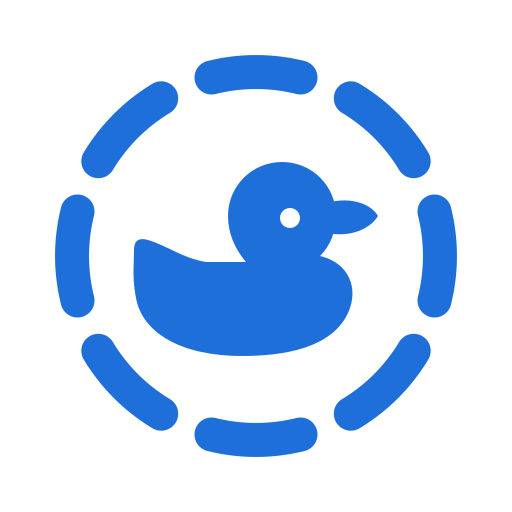

# Duck Share

[![CI status][ci-badge]][ci-workflow]

[ci-badge]: https://github.com/n1th1n-19/duck-share/actions/workflows/ci.yml/badge.svg
[ci-workflow]: https://github.com/n1th1n-19/duck-share/actions/workflows/ci.yml



**Website:** <https://n1th1n-19.github.io/duck-share/> · [Privacy policy](https://n1th1n-19.github.io/duck-share/privacy.html)

Duck Share shares files and messages between nearby devices over your local network, with no internet connection and no account. On Android, **hold two phones together** and the file goes across, like AirDrop or Quick Share — even when Duck Share is closed on both phones.

Duck Share is a fork of [LocalSend](https://github.com/localsend/localsend) and speaks the same protocol, so it works with every LocalSend device on Windows, macOS, Linux, iOS and Android.

- [Features](#features)
- [Tap to share](#tap-to-share)
- [Trusted and blocked devices](#trusted-and-blocked-devices)
- [Setup](#setup)
- [How it works](#how-it-works)
- [Getting started](#getting-started)
- [Command line interface](#command-line-interface)
- [Troubleshooting](#troubleshooting)
- [Building](#building)
- [Credits and license](#credits-and-license)

## Features

Everything LocalSend does, plus:

- **Tap to share (Android):** hold two phones back to back to send. No pairing, no picking a device from a list.
- **Works with the app closed:** share from any app via **Share → Duck Share**; the receiving phone wakes up from the tap and saves the file in the background.
- **Clear feedback:** both phones vibrate on touch and when done; the sender sees live progress, the receiver gets a "Received…" notification that opens the file.
- **Where to touch:** the app shows where the NFC antenna sits on your phone (read from the phone on Android 14+, estimated before).
- **History with previews:** received photos and videos show thumbnails; tap one to open it.
- **Trusted devices:** files from devices you trust arrive without a prompt, skip your PIN, and shared text lands on your clipboard.
- **Blocked devices:** requests from blocked devices are declined and they are hidden from the nearby list.

## Tap to share

Requires two Android phones with NFC (host card emulation) on the same Wi-Fi.

**Send**

1. In any app (Gallery, Files, …) tap **Share → Duck Share**. A sheet slides up: *Hold near another phone*.
2. Hold the phones back to back, camera ends lined up.
3. Pull them apart when both vibrate. The sheet shows the progress, then **Sent**; tap more phones to send to them too.
   **Hide** (or Back) keeps sending in the background, and **Open Duck Share** shows the transfer in the app.

Inside Duck Share, selecting files on the Send tab and tapping another phone works the same way.

**Receive**

Nothing to do: keep the screen on and unlocked. Duck Share may be closed. The phone vibrates on touch and again when the file is saved, and the notification opens it.

**Good to know**

- The touch only exchanges the address and the security fingerprint (well under a second). The file itself goes over Wi-Fi, so the phones can be apart while it transfers.
- Not sure where to touch? Settings → Tap to share → *Where is NFC on my phone?* shows the spot on the back of your phone.
- Taps from a locked phone, or from a device that was not tapped, show the normal accept prompt.
- Turn tap to share on or off with the **Tap to share** tile in Quick Settings or in Duck Share's settings.
- **Pixel phones:** Google's own *Tap to Share* (Quick Share) competes for NFC. Turn it off under *Settings → Connected devices → Connection preferences → Quick Share* if taps are unreliable.

## Trusted and blocked devices

When an unknown device sends you something, the receive screen asks **Trust this device?**

- **Always allow** — the device becomes trusted (it is also listed under favorites). Trusted devices skip the prompt and the receive PIN, and text they share is copied to your clipboard. You are never asked again.
- **Block** — the request is declined; future requests are declined silently.

Long-press a device on the Send tab, or open **Settings → Trusted & blocked devices**, to change it later. Trust is tied to the device's TLS certificate, so another device cannot pretend to be a trusted one.

## Setup

Duck Share should work out of the box. If devices cannot see each other, allow Duck Share through your firewall:

| Traffic Type | Protocol | Port  | Action |
|--------------|----------|-------|--------|
| Incoming     | TCP, UDP | 53317 | Allow  |
| Outgoing     | TCP, UDP | Any   | Allow  |

On Linux with `ufw`: `sudo ufw allow 53317`. With `firewalld`: `sudo firewall-cmd --permanent --add-port=53317/tcp`, `sudo firewall-cmd --permanent --add-port=53317/udp`, then `sudo firewall-cmd --reload`.

Also make sure AP isolation is disabled on your router (guest networks often enable it).

**Portable mode:** create an empty `settings.json` next to the executable; settings are stored there instead of the default location.

**Start hidden:** pass `--hidden` to start in the tray only.

## How it works

<picture>
  <source media="(prefers-color-scheme: dark)" srcset="support/readme/architecture-dark.svg">
  
</picture>

Every package rests on what it depends on: the app talks to the Rust core through the isolates layer, while the CLI and the signaling server use the core directly.

Devices talk to each other over a REST API using HTTPS. Each device generates its TLS certificate on the fly, and the peer identity is the SHA-256 fingerprint of that certificate. See the [LocalSend protocol](https://github.com/localsend/protocol) for details.

Tap to share adds an NFC handshake in front of it: the receiving phone emulates a card (Android host card emulation, AID `F04C4F43414C53454E44`) that answers with its alias, port, local IPs and certificate fingerprint. The sender reads it in NFC reader mode, connects over HTTPS pinned to that fingerprint, and starts a normal transfer. The fingerprint coming from physical contact makes the connection harder to intercept than LAN discovery.

## Getting started

To build Duck Share from source:

1. Install Flutter [directly](https://flutter.dev) or with [fvm](https://fvm.app) (see the [required version](.fvmrc))
2. Install [Rust](https://www.rust-lang.org/tools/install)
3. Clone this repository
4. `cd app`
5. `fvm flutter pub get`
6. `fvm flutter run`

> [!NOTE]
> Duck Share pins its Flutter version in [.fvmrc](.fvmrc). Use `fvm flutter` instead of a system-wide `flutter` to avoid build issues from a version mismatch.

The app icons for every platform are generated from [support/branding](support/branding/README.md).

## Command line interface

The repository also contains a terminal client (`localsend-cli`) built on the same protocol, so it works with Duck Share too.
Run `localsend-cli --help` to see every option.

```shell
localsend-cli send report.pdf photo.jpg ./project-backup
localsend-cli send --to "Cute Tomato" report.pdf
localsend-cli send --to 192.168.27.26 --text "hello"
```

Without `--to`, the command opens the list of discovered devices. An IP address is probed directly over HTTPS on the default port (`53317`).

## Troubleshooting

| Issue              | Platform (Sending) | Platform (Receiving) | Solution                                                                                                                                |
|--------------------|--------------------|----------------------|-----------------------------------------------------------------------------------------------------------------------------------------|
| Tap does nothing   | Android            | Android              | Turn on NFC on both phones; keep the receiver's screen on and unlocked; line up the camera ends and hold still for a second.            |
| Tap does nothing   | Pixel              | Android              | Turn off Google's *Tap to Share* (Quick Share settings); it takes over NFC.                                                             |
| "Could not send"   | Android            | Android              | Both phones must be on the same Wi-Fi.                                                                                                  |
| Device not visible | Any                | Any                  | Disable AP isolation on your router. If it is enabled, connections between devices are forbidden.                                      |
| Device not visible | Any                | Windows              | Set your network to "private". Windows is more restrictive on public networks.                                                          |
| Device not visible | macOS, iOS         | Any                  | Toggle the "Local Network" permission under "Privacy" in the OS settings.                                                               |
| Device not visible | Any                | Any                  | If a VPN is active, allow local/LAN traffic or disable the VPN.                                                                         |
| Device not visible | Any                | Any                  | Send manually to the receiver's IP address. If that works, add the device to favorites so it is probed directly.                       |
| Speed too slow     | Any                | Any                  | Use 5 GHz; disable encryption on both devices.                                                                                          |

## Building

Run from the `app` directory.

| Platform | Command |
|----------|---------|
| Android APK | `fvm flutter build apk` |
| Android App Bundle | `fvm flutter build appbundle` |
| iOS | `fvm flutter build ipa` |
| macOS | `fvm flutter build macos` |
| Windows | `fvm flutter build windows` (MSIX: `fvm flutter pub run msix:create`) |
| Linux | `fvm flutter build linux` (AppImage: `appimage-builder --recipe AppImageBuilder.yml`) |

Release APKs need a signing key: create `app/android/key.properties`, or sign with the debug key (see [CONTRIBUTING.md](CONTRIBUTING.md#compile-a-release-apk)).

## Credits and license

Duck Share is based on [LocalSend](https://github.com/localsend/localsend) by Tien Do Nam and contributors, and is licensed under the [Apache License 2.0](LICENSE), like the original. "LocalSend" and its logo belong to their owners; Duck Share is not affiliated with or endorsed by the LocalSend project.
